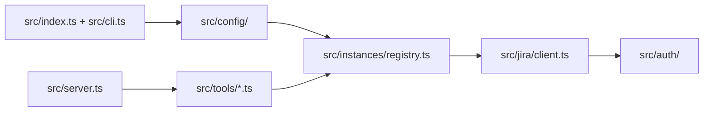

# Architecture

> **Purpose:** describe how the server is built so that people and agents can change it safely.
> **Keep up to date:** module list, configuration precedence, routing order and the tool contract. Review this page when `src/config/`, `src/instances/`, `src/tools/shared.ts` or `src/server.ts` change.

## Modules

| Module | Responsibility |
|---|---|
| `src/index.ts`, `src/cli.ts` | Entry point and CLI: `serve` (default), `login`, `logout`, `instances`. Flags after `--instance <name>` apply to that instance. |
| `src/config/` | Types, normalisation and inference (auth method, deployment, REST version) and loading from every source. |
| `src/auth/` | Auth providers (basic, bearer, browser), cookie store (`session.json`, `0600`) and Playwright browser login. |
| `src/instances/` | `InstanceRegistry` (add, remove, default, routing), `LoginManager` (background logins) and session keep-alive. |
| `src/jira/` | REST client for Cloud (v3) and Data Center (v2), Markdown ↔ ADF conversion and compact output formatting. |
| `src/tools/` | MCP tools: `instances.ts`, `issues.ts`, `metadata.ts`, `transfer.ts`, plus `shared.ts`. |
| `src/server.ts` | Builds the `McpServer` and the instructions that describe the configured instances to the assistant. |
| `src/logger.ts` | Logs to stderr and redacts every registered secret. |

## Configuration precedence

`loadConfig` (`src/config/load.ts`) merges, from highest to lowest priority: **CLI flags > environment variables > config file > defaults**. Instances with the same name are merged field by field across sources. A global read-only setting marks every instance as read-only.

## Routing

`InstanceRegistry.resolve` picks one instance in this order: the `instance` argument, an `instance:KEY-1` prefix, the host and path of a pasted browse URL, the project-key mapping (`projects`), the default instance, and finally the only configured instance. If none applies, it fails with a message that names the options. `InstanceRegistry.select` returns several instances for fan-out tools (`instances` or `allInstances`).

## Tool contract

Every tool is registered with `defineTool` (`src/tools/shared.ts`):

- Input is a zod shape; `instanceArg`, `issueArg` and `fanOutArgs` keep argument names and descriptions consistent.
- Output is JSON text. Errors become `isError: true` results; `UserError` messages are meant to be shown to the user.
- Annotations: `READ_ONLY`, `WRITE` or `DESTRUCTIVE`, always with `openWorldHint`.
- Write tools call `ensureWritable` before any request, so read-only instances never receive writes.
- Fan-out tools use `fanOut`, which returns one entry per instance and never hides the results of healthy instances.

Adding a tool is described step by step in the [`add-mcp-tool` skill](../.github/skills/add-mcp-tool/SKILL.md).

## Tests

Vitest suites live in `tests/`. `tests/helpers/fake-jira.ts` routes `"<METHOD> <host> <path>"` to handlers, so tests cover Cloud and Data Center without network access. `tests/server.test.ts` drives the real MCP server through an in-memory client.
