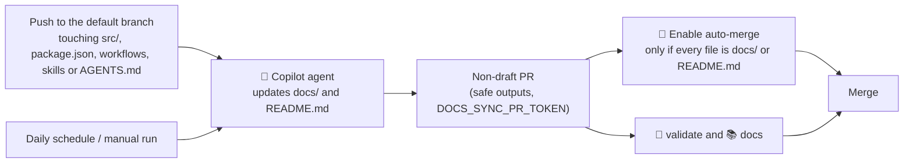

# 🌙 Lights-out

> **Purpose:** explain which pull requests merge without human review, why it is safe, and the workflows that do it.
> **Keep up to date:** allowed areas, protected paths, size limits and secrets. Review this page when `lights-out-assign.yml`, `lights-out-automerge.yml`, `.github/scripts/lights-out-guard.sh` or `docs-sync.md` change.

*Lights-out* is the mode in which a pull request merges without human review because the change is safe by construction. It covers two lanes: documentation kept in sync by `📚 Docs sync`, and small Copilot cloud agent PRs for Issues triaged as simple and low risk. In both lanes the required checks `🧪 validate` and `📚 docs` remain the final barrier.

## 📚 Docs sync

The agentic workflow `📚 Docs sync` (`.github/workflows/docs-sync.md`, compiled to `docs-sync.lock.yml`) keeps `docs/` and `README.md` in sync with the code.



1. **Trigger.** A push to `develop` or `main` that changes code or factory files, a daily reconciliation run, or a manual run. A push that only touches docs does not start it, so there is no loop.
2. **No overlaps.** If a previous docs sync PR is still open (label `🌙 lights-out` and title starting with `docs:`), the run is skipped.
3. **Agent.** It compares the pages with the code (the code wins), can only edit `docs/` and `README.md`, and runs markdownlint and the link check before opening the PR. If there is nothing to update, it calls `noop`.
4. **PR.** The `safe_outputs` job creates it with `draft: false`. Any file outside `docs/**` and `README.md` blocks the output (`allowed-files`). `README.md` is protected by default by gh-aw and is allowed explicitly; `AGENTS.md`, `CODEOWNERS`, `package.json` and `.github/` stay protected.
5. **Auto-merge.** The `🔀 Enable auto-merge` job runs outside the agent, only when the `agent` job succeeded (including the Markdown post-steps), and only on the PR just created: not a draft, from this repository, targeting the default branch, and every file under `docs/` or `README.md`. Otherwise it does nothing and the PR waits for a person.

The PR is created with a user token because PRs created with the default `GITHUB_TOKEN` do not trigger `pull_request` workflows, so the required checks would never run.

After any change to an agentic workflow `.md`, recompile and commit the lock file:

```sh
gh aw compile docs-sync
```

The generated `.lock.yml` files are not edited by hand, so they cannot follow every repository convention: generated jobs and steps have no emoji, Dependabot ignores them (they are updated by recompiling), and `actionlint` reports false positives on them (`queue` in `concurrency`, `job.workflow_ref`, the `copilot-requests` permission) because it does not know those newer keys yet. `gh aw compile` also maintains `.github/aw/actions-lock.json` and `.gitattributes`.

## Automatic assignment of simple Issues

The workflow `🌙 Lights-out assign` (`.github/workflows/lights-out-assign.yml`) moves simple, ready Issues to the autonomous lane. It evaluates **all current labels** on every `labeled` event, because triage does not guarantee an order. Every condition must hold:

- The Issue is open.
- It has `✅ agent-ready` and `🟢 complexity-low`.
- It has an allowed area: `📝 documentation` or `🧩 tools` (variable `ALLOWED_AREA_LABELS` at the top of the workflow).
- It has neither `🏭 software-factory` nor `🔐 auth`.
- Whoever added the label has `write` permission or higher.

Then it assigns the Issue to `copilot-swe-agent[bot]` with the default branch as base, swaps `💡 lights-on` for `🌙 lights-out` and comments the reason. It is idempotent: it does nothing if Copilot is already assigned or already has an open PR for the Issue.

## Auto-merge of cloud agent PRs

The workflow `🔀 Lights-out auto-merge` (`.github/workflows/lights-out-automerge.yml`) closes the lane. It runs with `pull_request_target`, so the workflow and the guard script always come from the default branch and a PR cannot edit them. It never checks out or runs PR code. The decision lives in `.github/scripts/lights-out-guard.sh`; every condition must hold:

- The PR is open, authored by Copilot, comes from this repository and targets the default branch.
- It closes at least one Issue, and every closing Issue is open, `🌙 lights-out` and not `🏭 software-factory`.
- The diff is small: up to 150 changed lines (`MAX_CHANGED_LINES`) and 10 files (`MAX_CHANGED_FILES`).
- No file, including the old name of a renamed file, is in `.github/`, `.vscode/` or `src/auth/`, or is `AGENTS.md`, `package.json`, `package-lock.json` or `.npmrc`.

If eligible, it marks the PR ready and runs `gh pr merge --auto --squash --match-head-commit <evaluated SHA>`. If a Copilot PR stops being eligible after a new push or edit, the workflow cancels its auto-merge. Known limit: closing the Issue or removing `🌙 lights-out` after auto-merge is enabled does not re-evaluate the PR; disable it by hand with `gh pr merge <n> --disable-auto`.

Test the guardrails locally:

```sh
bash .github/scripts/lights-out-guard.test.sh
```

## Secrets

Create them in *Settings → Secrets and variables → Actions*. No secret is versioned. Use fine-grained tokens limited to this repository, with an expiry date.

| Secret | Used by | Permissions |
|---|---|---|
| `TRIAGE_TOKEN` | `🚦 Triage` (adds labels so that `🌙 Lights-out assign` is triggered) | **Issues: Read and write**, **Metadata: Read** |
| `COPILOT_ASSIGN_TOKEN` | `🌙 Lights-out assign` (assigns Copilot) and `🔀 Lights-out auto-merge` (ready + auto-merge) | **Metadata: Read**; **Actions**, **Contents**, **Issues** and **Pull requests: Read and write**. The `GITHUB_TOKEN` cannot assign Copilot. |
| `DOCS_SYNC_PR_TOKEN` | `📚 Docs sync` (creates the PR so the required checks run) | **Contents** and **Pull requests: Read and write**, **Metadata: Read**. No *Workflows* permission. |
| `GH_AW_CI_TRIGGER_TOKEN` (optional) | `🔁 Triage learn` | Same as `DOCS_SYNC_PR_TOKEN`. Without it, the PR checks do not start until a person closes and reopens the PR. |

The agent inference itself needs no secret: the agentic workflows declare `copilot-requests: write`.

## What stays protected

Governance (`.github/`, `.vscode/`, `AGENTS.md`), credential handling (`src/auth/`) and the supply chain (`package.json`, `package-lock.json`) keep a code owner and are excluded from the autonomous lane. A PR that mixes other paths with any of those needs human review, because CODEOWNERS is evaluated per file.
