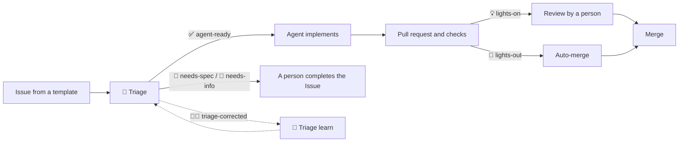

# Software factory

> **Purpose:** explain the path of a change: Issue template → triage → agent → review → merge.
> **Keep up to date:** templates and labels, the triage summary, CI checks and code ownership. Review this page when `.github/ISSUE_TEMPLATE/`, `.github/labels.yml`, `.github/skills/triage-issue/`, `.github/workflows/` or `.github/CODEOWNERS` change.

## Path of a change

## 1. Issue from a template

Blank Issues are disabled (`.github/ISSUE_TEMPLATE/config.yml`), and vulnerabilities go to a private security advisory. Available templates:

| Template | Initial labels |
|---|---|
| 🐛 Report a bug | `🐛 bug`, `🔍 needs-triage` |
| ✨ Enhancement | `✨ enhancement`, `🔍 needs-triage` |
| 🧰 New MCP tool | `🧰 new-tool`, `🔍 needs-triage` |
| 🏭 Software factory change | `🏭 software-factory`, `🔍 needs-triage` |

Labels are declared in `.github/labels.yml` and created by the `🏷️ Sync labels` workflow (run it by hand once after merging this setup). The `🏭 Factory checks` workflow validates the templates with `check-jsonschema` and fails if a template uses a label that is not declared.

## 2. Triage

The triage is a skill, `.github/skills/triage-issue/`: `SKILL.md` describes the procedure and `references/rules.md` holds the rules and examples. The agentic workflow `🚦 Triage` (`.github/workflows/triage.md`) runs it on every opened or reopened Issue. Summary of the decisions:

- Status, exactly one: `✅ agent-ready` (clear and verifiable), `📐 needs-spec` (needs a design) or `💬 needs-info` (missing information or an unticked mandatory confirmation).
- Lights, only for `✅ agent-ready`: `💡 lights-on` when the behaviour of the server changes; `🌙 lights-out` when only documentation changes.
- Complexity, exactly one: `🟢 complexity-low`, `🟡 complexity-medium` (every `🧰 new-tool`) or `🔴 complexity-high` (auth, routing, config loading, architecture, dependencies).
- Area, at most one: `🔐 auth`, `🧭 routing`, `🧩 tools`, `🔌 jira-api`, `⚙️ config`, `📝 documentation` or `🚀 ci-release`. None for `🏭 software-factory`.
- `🏭 software-factory` Issues are never `🌙 lights-out`.

The agent cannot write directly: labels, the label removal and the comment are gh-aw *safe outputs* restricted to an allow-list. The labels are added with the `TRIAGE_TOKEN` user token on purpose, because label events created with the `GITHUB_TOKEN` do not trigger other workflows and [`🌙 Lights-out assign`](lights-out.md#automatic-assignment-of-simple-issues) must react to them.

### The factory learns

When a person fixes a wrong triage, they add `🧑‍🏫 triage-corrected`. The agentic workflow `🔁 Triage learn` (`.github/workflows/triage-learn.md`) then opens a pull request that only adds an example to `references/rules.md`. It is always reviewed by a person (`.github/` has a code owner) and `🥷 Validate skills` measures it with waza, failing if the file grows more than 10%.

## 3. Agent

An agent implements the Issue following `AGENTS.md` and `.github/copilot-instructions.md`, helped by the skills and hooks described in [Skills and MCP](skills-and-mcp.md). The Copilot cloud agent gets its environment from `copilot-setup-steps.yml`. GitHub Flow: a focused branch with the Issue number and Conventional Commits.

## 4. Pull request and checks

| Workflow | Check | When |
|---|---|---|
| `ci.yml` | `🧪 validate` (aggregates the OS × Node matrix: typecheck, tests, build, CLI smoke test) | Every PR; **required** |
| `docs.yml` | `📚 docs` (markdownlint and relative links) | Every PR; **required** |
| `validate-skills.yml` | `🧩 validate skills` (waza readiness and token budget) | When `.github/skills/` changes |
| `factory-checks.yml` | Templates, labels, guardrail tests and hooks | When the factory changes |
| `pr-labels.yml` | Copies category and lights labels from the closing Issues to the PR | Every PR |

- `🏷️ PR labels` runs with `pull_request_target`, never checks out PR code, never copies status labels (`🔍 needs-triage`, `✅ agent-ready`…) and never removes labels. PRs that change `references/rules.md` get `🔁 triage-learning`, `🏭 software-factory`, `🤖 agents` and `💡 lights-on`.
- Workflow, job and step names start with an emoji, and actions are pinned to a full commit SHA (see `.github/copilot-instructions.md`). Dependabot keeps them up to date.

## 5. Review and merge

`.github/CODEOWNERS` assigns an owner only to governance (`AGENTS.md`, `.github/`, `.vscode/`), credential handling (`src/auth/`) and the supply chain (`package.json`, `package-lock.json`). There is no `*` rule. Who reviews what is detailed in [Guardrails](guardrails.md#who-reviews-what). Agents never merge on their own: integration needs explicit approval, except for the 🌙 lights-out lane described in [Lights-out](lights-out.md).

## 6. Release

A GitHub Release published by a maintainer runs `🚀 Publish to npm` (`publish.yml`), which stages the package on npm with trusted publishing; a maintainer approves it with 2FA. See [Releasing](releasing.md).

## One-time repository setup

1. Merge this setup and run *Actions → 🏷️ Sync labels → Run workflow*.
2. Create the secrets described in [Lights-out](lights-out.md#secrets) and in the triage section above.
3. Enable *Settings → General → Allow auto-merge*.
4. Create a ruleset for the default branch that requires a pull request, a code owner review, and the checks `🧪 validate` and `📚 docs`.
5. Enable the Copilot cloud agent for the repository.
6. Follow the [one-time setup for npm releases](releasing.md#one-time-setup).
